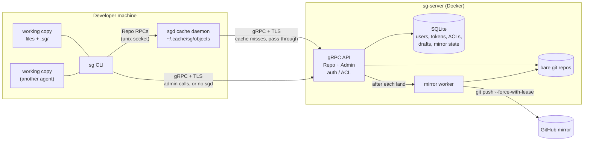

# sgit

Scion-style source control on top of git. Git runs only on the server, and clients have no `.git` directory. Inspired by Anthropic's [Redesigning source control](https://www.anthropic.com/engineering/redesigning-source-control).

## Features

- **Thin clients.** `sg` keeps only your files plus a small `.sg/` folder. There is no `.git` and no `git add`.
- **Server-side commits.** Commits, rebases and 3-way merges run on the server.
- **One-step land.** `sg commit --land` creates a draft, rebases it on `main` and lands it in one round trip. `main` moves by compare-and-swap, so concurrent lands never lose work.
- **Drafts.** A commit without `--land` becomes a draft that you can update, show, land or abandon.
- **Sparse checkouts** with `--path`, and history (`log`, `blame`, `cat`) without a checkout at all.
- **Shared object cache.** The `sgd` daemon lets many working copies and agents on one machine share a single download. Every cached object is hash-verified.
- **Auth.** Per-user tokens, TLS, per-repo `read`/`write` access, and global admins.
- **GitHub mirror.** The server pushes `main` to GitHub after every land. It never overwrites commits made on GitHub, and retries with backoff.
- **Import** of a repo from any git URL. Only `main` and `release/*` are copied.
- **Scriptable.** Every command accepts `--json` and returns stable exit codes.
- **Docker.** Multi-arch server images are published at `ghcr.io/hermes98761234/sgit-server`.

## Architecture



- **`sg-server`** owns the git repos and is the source of truth.
- **`sg`** sends file changes and asks the server to commit, rebase and land them.
- **`sgd`** is optional. It serves objects from a local cache and passes every other call through with your token.
- **GitHub** is a read-only copy of `main`, for CI, browsing and backup.

## 1. Server setup

1. **Clone the repo**, which includes `docker-compose.yml`:
   ```bash
   git clone https://github.com/hermes98761234/sgit && cd sgit
   ```
2. **Edit `docker-compose.yml`.**
   - Set `SG_TLS_HOSTS` to the hostname that clients will use, for example `sg.example.com,localhost`.
   - Optionally, replace `build: .` with `image: ghcr.io/hermes98761234/sgit-server:latest` to use the published image.
3. **Start the server** and check it:
   ```bash
   docker compose up -d
   docker compose exec sg-server sg-server health                 # prints SERVING
   ```
4. **Get the admin token and the certificate.** Clients need both.
   ```bash
   docker compose exec sg-server cat /data/admin-token
   docker compose cp sg-server:/data/tls/cert.pem ./cert.pem
   ```
5. **Create a repo and a user:**
   ```bash
   docker compose exec sg-server sh -c 'sg login localhost:7419 --ca /data/tls/cert.pem --token "$(cat /data/admin-token)"'
   docker compose exec sg-server sg repo create web
   docker compose exec sg-server sg token create bob              # prints bob's token once
   docker compose exec sg-server sg acl grant bob web write
   ```
6. **Optional: mirror to GitHub.**
   1. Give the server credentials. See [Mirror credentials](docs/server.md#mirror-credentials).
   2. Create the repo with an empty GitHub mirror: `sg repo create web --mirror git@github.com:acme/web.git`.
   3. Or import an existing project and mirror it back: `sg repo import web --from URL --mirror URL`.

More in the **[server guide](docs/server.md)**: configuration, running without Docker, administration, import and mirroring, and releases.

## 2. Client setup (`sg`)

1. **Install** (needs Go):
   ```bash
   go install github.com/hermes98761234/sgit/cmd/sg@latest
   ```
2. **Log in** with your token and the server certificate:
   ```bash
   sg login sg.example.com:7419 --token "$TOKEN" --ca cert.pem
   ```
3. **Check out** a repo (add `--path src` for a sparse checkout):
   ```bash
   sg checkout web && cd web
   ```
4. **Work and land:**
   ```bash
   sg status
   sg diff
   sg commit -m "fix the thing" --land
   ```
5. **Stay up to date** with `sg sync`.

More in the **[client guide](docs/client.md)**: all commands, drafts, conflicts and exit codes.

## 3. Cache daemon setup (`sgd`, optional)

1. **Install:**
   ```bash
   go install github.com/hermes98761234/sgit/cmd/sgd@latest
   ```
2. **Run it** in front of your server:
   ```bash
   sgd --upstream sg.example.com:7419 --ca cert.pem
   ```
3. **Done.** `sg` uses it automatically. Set `SG_NO_DAEMON=1` to bypass it.

More in the **[sgd guide](docs/sgd.md)**: the systemd user service, socket and cache settings, and security.

## Docs

- [Server guide](docs/server.md)
- [Client guide](docs/client.md)
- [Cache daemon guide](docs/sgd.md)
- [Design spec](docs/superpowers/specs/2026-10-14-sgit-design.md)

## License

MIT
