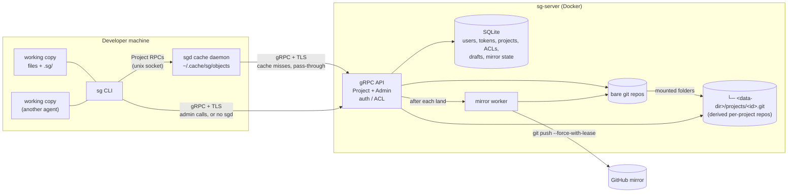

# sgit

Scion-style source control on top of git. Git runs only on the server, and clients have no `.git` directory. Inspired by Anthropic's [Redesigning source control](https://www.anthropic.com/engineering/redesigning-source-control).

## Features

- **Thin clients.** `sg` keeps only your files plus a small `.sg/` folder. There is no `.git` and no `git add`.
- **Server-side commits.** Commits, rebases and 3-way merges run on the server.
- **One-step land.** `sg commit --land` creates a draft, rebases it on `main` and lands it in one round trip. `main` moves by compare-and-swap, so concurrent lands never lose work.
- **Drafts.** A commit without `--land` becomes a draft that you can update, show, land or abandon.
- **Sparse checkouts** with `--path`, and history (`log`, `blame`, `cat`) without a checkout at all.
- **Shared object cache.** The `sgd` daemon lets many working copies and agents on one machine share a single download. Every cached object is hash-verified.
- **Projects.** Per-folder views of one or more repos, with per-project `read`/`write` access, aliases and read-only mounts. Clients never see repos.
- **Auth.** Per-user tokens, TLS and global admins.
- **GitHub mirror.** The server pushes `main` to GitHub after every land. It never overwrites commits made on GitHub, and retries with backoff.
- **Import** of a repo from any git URL. Only `main` and `release/*` are copied.
- **Scriptable.** Every command accepts `--json` and returns stable exit codes.
- **Docker.** Multi-arch server images are published at `ghcr.io/hermes98761234/sgit-server`.

## Architecture



- **`sg-server`** owns the git repos and is the source of truth. Each project gets a derived repo in `<data-dir>/projects/<id>.git`, built from the folders it mounts.
- **Auth:** tokens → user → per-project read/write, admin role.
- **`sg`** works on a project. It sends file changes and asks the server to commit, rebase and land them.
- **`sgd`** is optional. It serves objects from a local cache and passes every other call through with your token.
- **GitHub** is a read-only copy of `main`, for CI, browsing and backup.

## 1. Server setup

1. **Clone the repo**, which includes `docker-compose.yml`:
   ```bash
   git clone https://github.com/hermes98761234/sgit && cd sgit
   ```
2. **Edit `docker-compose.yml`.**
   - Set `SG_TLS_HOSTS` to the hostname that clients will use, for example `sg.example.com,localhost`.
   - Optionally, replace `build: .` with `image: ghcr.io/hermes98761234/sgit-server:latest` to use the published image.
3. **Start the server** and check it:
   ```bash
   docker compose up -d
   docker compose exec sg-server sg-server health                 # prints SERVING
   ```
4. **Get the admin token and the certificate.** Clients need both.
   ```bash
   docker compose exec sg-server cat /data/admin-token
   docker compose cp sg-server:/data/tls/cert.pem ./cert.pem
   ```
5. **Create a repo, a project and a user.** Users never see repos; they get access to projects. A project mounts folders of one or more repos.
   ```bash
   docker compose exec sg-server sh -c 'sg login localhost:7419 --ca /data/tls/cert.pem --token "$(cat /data/admin-token)"'
   docker compose exec sg-server sg repo create web
   docker compose exec sg-server sg project create web
   docker compose exec sg-server sg project mount web . web:.       # the whole repo at the project root
   docker compose exec sg-server sg token create bob              # prints bob's token once
   docker compose exec sg-server sg acl grant bob web write
   ```
   Manage them later with `sg project list|show|mount|unmount|alias|rename|delete`, `sg user list|promote|demote|delete`, `sg token list|revoke`, `sg acl list|revoke` and `sg repo list|delete`.
6. **Optional: mirror to GitHub.**
   1. Give the server credentials. See [Mirror credentials](docs/server.md#mirror-credentials).
   2. Create the repo with an empty GitHub mirror: `sg repo create web --mirror git@github.com:acme/web.git`.
   3. Or import an existing git repo and mirror it back: `sg repo import web --from URL --mirror URL`. Mount it into a project to give users access.

More in the **[server guide](docs/server.md)**: configuration, running without Docker, administration, import and mirroring, and releases.

## 2. Client setup (`sg`)

1. **Install** a binary from the [latest release](https://github.com/hermes98761234/sgit/releases/latest), or build it with Go:
   ```bash
   go install github.com/hermes98761234/sgit/cmd/sg@latest
   ```
2. **Log in** with your token and the server certificate:
   ```bash
   sg login sg.example.com:7419 --token "$TOKEN" --ca cert.pem
   ```
3. **List your projects and check one out** (add `--path src` for a sparse checkout). Name a project by its name, an alias or `#<id>`:
   ```bash
   sg projects
   sg checkout <project> && cd <project>
   ```
4. **Work and land:**
   ```bash
   sg status
   sg diff
   sg commit -m "fix the thing" --land
   ```
5. **Stay up to date** with `sg sync`.

More in the **[client guide](docs/client.md)**: all commands, drafts, conflicts and exit codes.

## 3. Cache daemon setup (`sgd`, optional)

1. **Install:**
   ```bash
   go install github.com/hermes98761234/sgit/cmd/sgd@latest
   ```
2. **Run it** in front of your server:
   ```bash
   sgd --upstream sg.example.com:7419 --ca cert.pem
   ```
3. **Done.** `sg` uses it automatically. Set `SG_NO_DAEMON=1` to bypass it.

More in the **[sgd guide](docs/sgd.md)**: the systemd user service, socket and cache settings, and security.

## 4. AI agent skills (Claude Code, Codex, Cursor)

Two [Agent Skills](https://agentskills.io) teach coding agents how to use sgit:

| Skill | For | Covers |
|---|---|---|
| [`sgit-admin`](skills/sgit-admin/SKILL.md) | admins | `sg-server`, users (create, list, promote, demote, delete), tokens (create, list, rotate, revoke), projects (create, mount, unmount, alias, rename, delete), per-project access (`acl grant`/`list`/`revoke`), repos (create, import, delete), mirroring |
| [`sgit-client`](skills/sgit-client/SKILL.md) | developers and agents | login, `sg projects`, checkout, status/diff, `commit --land`, drafts, sync, conflicts, log/blame/cat, sparse, exit codes |

**In this repo** they work out of the box: `.claude/skills/`, `.agents/skills/` (Codex) and `.cursor/skills/` are symlinks to `skills/`.

**In your own projects or for your user**, copy the skills where your agent looks for them:

```bash
git clone https://github.com/hermes98761234/sgit
cd sgit

# Claude Code
cp -r skills/sgit-client skills/sgit-admin ~/.claude/skills/        # all projects
cp -r skills/sgit-client /path/to/project/.claude/skills/           # one project

# Codex
cp -r skills/sgit-client skills/sgit-admin ~/.agents/skills/        # all projects
cp -r skills/sgit-client /path/to/project/.agents/skills/           # one project

# Cursor
cp -r skills/sgit-client skills/sgit-admin ~/.cursor/skills/        # all projects
cp -r skills/sgit-client /path/to/project/.cursor/skills/           # one project
```

Create the target directory first if it doesn't exist. Give developers only `sgit-client`; install `sgit-admin` only where admin tokens are used.

**Use them** by just asking: the agent loads the skill when the task matches.

- Admin: "Create project site from web:public, give bob write access", "Create user bob with write access to web and give me the token", "Import github.com/acme/api as api and mirror it back", "Rotate alice's token".
- Client: "Check out web, fix the failing test and land it", "Sync and resolve the conflicts", "Who last changed src/main.go?".

You can also call them explicitly: `/sgit-admin` or `/sgit-client` in Claude Code, `$sgit-client` in Codex, `/sgit-client` in Cursor.

## Performance

Measured with v0.2.0 in Docker on one machine (8 CPUs, 31 GB RAM, git 2.45): `sg-server`, `sgd` and the clients each ran in their own container on a local network, over TLS. The test repo has 20,000 files of about 2.7 KB in 20 directories, plus 20 commits of history. The bare repo is 41 MB.

| Operation (20,000-file repo) | Time |
|---|---|
| `sg repo import` over ssh | 2.1 s |
| `sg checkout`, full, direct to server | 3.7 s |
| `sg checkout`, full, through a warm `sgd` cache | 3.1 s |
| `sg checkout --path d0` (sparse, 1,000 files) | 0.15 s |
| `sg status`, nothing changed | 0.2 s |
| `sg status` / `sg diff`, 100 files modified | 0.17 s / 0.2 s |
| `sg commit --land`, 1 file | 0.48 s |
| `sg commit --land`, 100 files modified | 0.64 s |
| `sg commit --land`, 1,000 new files | 1.7 s |
| `sg commit --land`, one 20 MB file | 2.5 s |
| `sg sync`, pulling 1,100 files and 20 MB | 1.9 s |
| `sg log -n 100`, `sg log <path>`, `sg blame` | 50–70 ms |
| `sg cat` of a 20 MB file | 0.23 s |

- **Small repos.** A one-file land takes about 60 ms. In large repos, landing still costs time proportional to the repo size: the client scans the working copy, and the server rebuilds the tree.
- **Many users.** 30 users, each with their own token, landed 10 rounds each on one repo at the same time. All 300 lands succeeded in 17 s, about 18 lands/s, with a p50 of 1.3 s and a p95 of 1.7 s per land. Lands that touch different files never conflict; the server rebases them. When many users edit the same file at the same moment, most of their lands conflict and have to be fixed by hand, as with git.
- **Robustness.** A randomized "monkey" run made about 6,300 sg calls while killing the server, restarting `sgd` and sending junk to the port. The calls included random edits, garbage arguments and `kill -9` mid-command. No call crashed or broke a working copy. At the end, every working copy matched `main` and `git fsck` was clean.

### Projects (in-process, same 20,000-file layout)

These numbers come from Go benchmarks: `go test -run '^$' -bench BenchmarkProject -benchtime 5x ./internal/cli/`. They were measured on one machine (Intel i7-4790, 8 CPUs, git 2.43). The setup differs from the v0.2.0 runs above in several ways, so do not compare the two tables row by row:

- Server and client run in one test process over loopback, without TLS, Docker or `sgd`, and share the same CPUs.
- Each figure is the mean of 5 iterations, and the first iteration is cold.
- The ranges cover two runs.

The repo `big` has the same 20,000 files in `d0`..`d19`, a seed commit and 119 one-file commits, so `sg log -n 100` returns 100 entries. Two project layouts are measured: 20 folder mounts (`d0`..`d19`) and one mount of the whole repo at `.`.

| Operation (project over the 20,000-file repo) | 20 folder mounts | whole repo at `.` |
|---|---|---|
| `sg checkout`, full | 2.3–2.4 s | 2.3–2.4 s |
| `sg commit --land`, 1 file | 0.70–0.86 s | 0.73–0.86 s |
| `sg log -n 100` (100 entries) | 10 ms | 8–10 ms |

With 5 iterations the land figure is noisy: the disk of this machine is nearly full, and a single fsync takes 10–16 ms on it. Longer runs (`-bench BenchmarkProjectLand -benchtime 20x`, two runs) give 0.55–0.58 s with 20 folder mounts and 0.63–0.64 s with a `.` mount. The same 20x runs of the previous build (commit 0e6a795), run alternately with these, gave 0.79–0.81 s and 0.74–0.77 s. `sg log` went from 14–17 ms to 8–10 ms because catch-ups no longer leave one small pack per translated commit in the project repo.

Most of a one-file land is spent in the client, which costs the same with or without projects: it scans the 20,000 files and saves its index twice (about 0.3 s here). On the server, small object copies are written as loose objects instead of an fsynced pack, the catch-up reads all folders of a repo with one git process, the source tree is built by replacing only the touched folder (no full index of the source repo), and the new project commits and the landed draft are stored in one SQLite transaction. The land is still slower than the 0.48 s in the v0.2.0 table, but the setups differ: here the client and server share one process and its CPUs, on different hardware.

## Docs

- [Server guide](docs/server.md)
- [Client guide](docs/client.md)
- [Cache daemon guide](docs/sgd.md)
- [Design spec](docs/superpowers/specs/2026-10-14-sgit-design.md)
- [Projects design spec](docs/superpowers/specs/2026-10-15-sgit-projects-design.md)

## License

MIT
